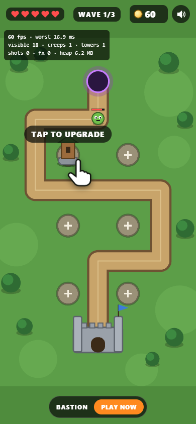
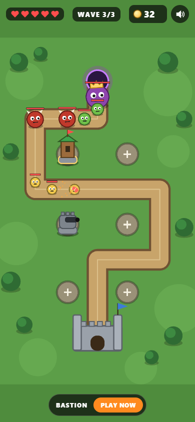

<h1 align="center">Bastion — tower defense playable ad</h1>

<p align="center">
  A 2D tower-defense playable ad on PixiJS, built to an explicit set of design rules: a rendering-free core, entities with doors, one observation channel, and an assembly point that reads like a table of contents.
</p>

<p align="center">
  <a href="https://s-afanasiev.github.io/bastion-td-playable/"><b>Live demo</b></a>
  &nbsp;·&nbsp;
  <a href="https://s-afanasiev.github.io/bastion-td-playable/play/preview/index.html?debug"><b>Full screen + perf overlay</b></a>
  &nbsp;·&nbsp;
  <a href="https://s-afanasiev.github.io/">All projects</a>
  <br>
  <a href="https://github.com/s-afanasiev/bastion-td-playable/actions/workflows/pages.yml"></a>
</p>

<p align="center">
  
  &nbsp;
  
</p>

## Gameplay (≈30 s)

A hand points at a stone spot → a radial menu offers **archer**, **cannon** and **frost** towers with their prices → the first tower starts the battle → three waves walk the winding road to the castle: grunts, fast runners, armoured brutes and a crowned boss → kills pay gold, gold buys towers and upgrades (the hand suggests the first upgrade as soon as it is affordable) → win when the waves are cleared, lose after five breaches or on time-out → end card where the whole screen is the store CTA.

## What the build guarantees

| | |
|---|---|
| **Single HTML** | Script and styles inlined; the build fails on any external `src`/`href`. ~558 KB raw, ~163 KB gzip — budget 700 KB. |
| **Network adapters** | One adapter per build: Meta `FbPlayableAd.onCTAClick()`, Google `ExitApi.exit()`, MRAID `mraid.open()` with `ready` / `viewableChange` handling, and a preview build. |
| **Ad lifecycle** | Starts after the network is ready; pause/resume of ticker and audio when the ad is hidden; audio unlocked on first tap; fits a 720×1280 logical field into any screen. |
| **Frame budget** | `?debug` overlay: FPS, worst frame, visible objects, creeps, towers, pool usage, JS heap. |

Measured with automated playthroughs in Edge on a GeForce GT 710 (an old entry-level GPU): a steady 60 FPS, worst frame 16.8–18.1 ms, up to 74 visible objects, JS heap 7.3–9.4 MB. Two scripted players play through the real UI — an active one (four towers, one upgrade) and one that only taps where the hand points; both win.

## Design rules and where they live

**The story first.** *The ad shows a short battle: the player builds towers on spots along a road, waves walk to the castle, towers shoot the creep furthest along the road, kills pay gold, gold buys towers and upgrades. The castle holds five breaches. After the waves — an end card with the store link.* Every noun in that paragraph is an object below; every verb is a method or a work.

**One assembly point** — [`src/main.js`](src/main.js). The whole tree is declared there and nothing else happens there; all numbers come from [`src/config.js`](src/config.js).

```
Playable(network, stage, battle, views, tutorial, synth)          lifecycle: run · pause ↔ resume · stop
  Battle(scenario, WavePlan, Creeps(Creep), Towers(Tower), Volleys, Treasury, Gate)   one frame of the core
  PlayerActions(scenario, towers, kinds, treasury, BuildTower, UpgradeTower, menu)    taps → works → verdicts
  Milestones ── subscribers: SpotsView · CreepsView · Sparks · Hud · Tutorial · EndCard · Toast · Flash · sounds · network.gameEnd
```

**A core that knows nothing about rendering.** [`src/core`](src/core) is plain JS: road, wave plan, creeps, towers, treasury, castle gate, ad scenario, projectiles. A test greps it for Pixi, DOM and network calls, and [`test/battle.test.js`](test/battle.test.js) replays whole battles in Node — no defence → the castle falls; sensible play → victory.

**Every node has one kind.**

| Kind | Nodes |
|---|---|
| Entity — identity, named states, doors | `Scenario` (intro → tutorial → battle → won \| lost → end), `Treasury`, `Gate`, `Creep` (walking → killed \| breached), `Tower` (level 1 → 2) |
| Work — a verb that takes entities as arguments | `BuildTower`, `UpgradeTower` |
| Policy — answers a question, changes nothing | `FirstOnRoad`, `FirstUnchilled` |
| Pure decision — time is an argument | `WavePlan.spawnsBetween(from, to)` |
| Repeater + instance | `Creeps` → a fresh `Creep` per spawn; `Towers` → a `Tower` per spot |
| Variant by replacing a node | impacts `SingleHit` / `SplashHit` / `ChillHit`, chosen by name in the tower table |
| Parent of a frame | `Battle` — children report facts, it decides consequences (gold, breaches, outcome) |

**Invariants live in doors, not in notifications.** Gold never goes negative (`Treasury.spend`), one tower per spot (`Towers.place`), a dead creep can't be hit (`Creep.hit`), illegal scenario transitions don't exist (a transition table). Every write returns `{ ok, code, detail }` and a refusal changes nothing; refusals reach the player as `action.refused` with a reason.

**One observation channel.** The core announces milestones (`tower.built`, `creep.killed`, `gate.breached`, …); views, HUD, sound, tutorial and the network adapter subscribe in one place. A milestone is a signal, never a command: the first tower starts the battle because `PlayerActions` calls `scenario.begin()`, not because something listens to `tower.built`.

**Every entry has an exit.** subscribe ↔ unsubscribe, pause ↔ resume, sprite lease ↔ idempotent release, menu open ↔ close, `run()` ↔ `stop()` in reverse order.

**Decisions recorded with the scenario that settled them.**

| Decision | Scenario that split the variants |
|---|---|
| `BuildTower` checks everything, then applies everything | *spot is free but gold is short*: "spend then place" would leave the player poorer with no tower; "check then apply" refuses and changes nothing |
| The menu closes **after** the work answers | *tutorial waits for the first tower*: closing first sent `menu.closed` before `tower.built`, and the tutorial rolled back to "tap to build" — caught by the automated playthrough |
| Menu button positions come from layout math, not the DOM | *the hand points at a button that is still animating in*: `getBoundingClientRect` returned the centre of the spot, and a player who followed the hand got stuck — caught by the "follow the hand" bot |
| `Creeps.all` is a public read-only array | *a policy picks a target for every tower every frame*: a callback-based iterator would allocate; on the hot path a plain indexed loop wins |

## Run

```bash
npm install
npm run dev     # http://127.0.0.1:5179 — preview build with hot reload
npm test        # core, battle replays, pool
npm run build   # dist/play/<network>/index.html for every network + dist/index.html showcase
```

Before a real campaign each file still goes through the network's own playable validator; the store URL in `src/config.js` is a placeholder.

---

<sub>A personal demo inspired by tower-defense games; not affiliated with any game or publisher.</sub>
